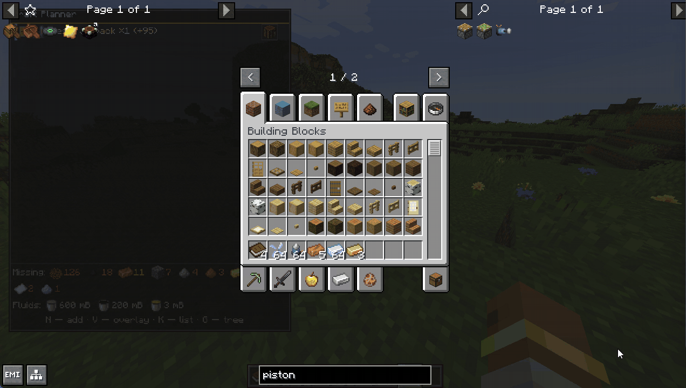
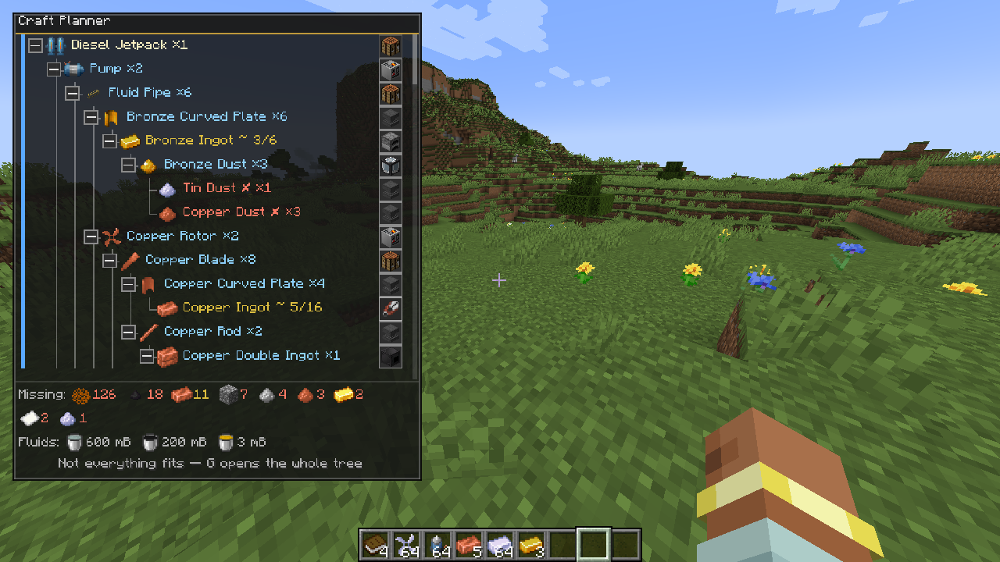
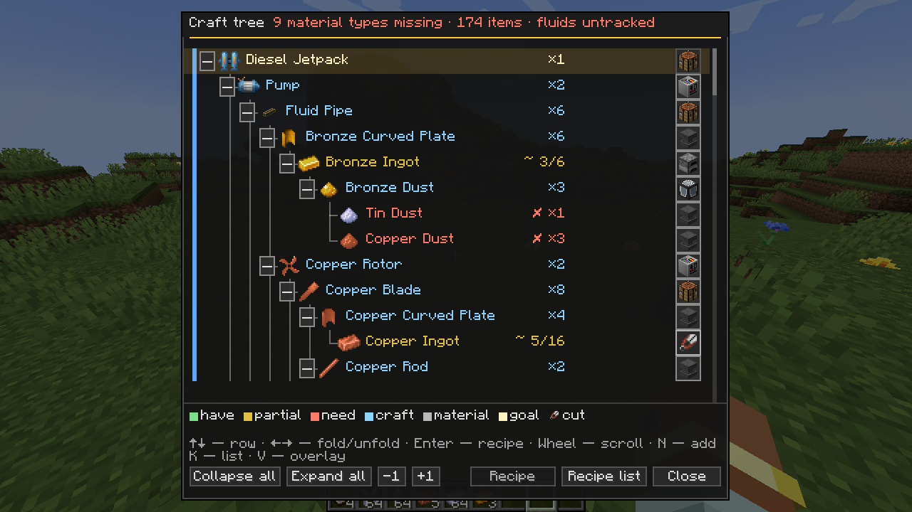
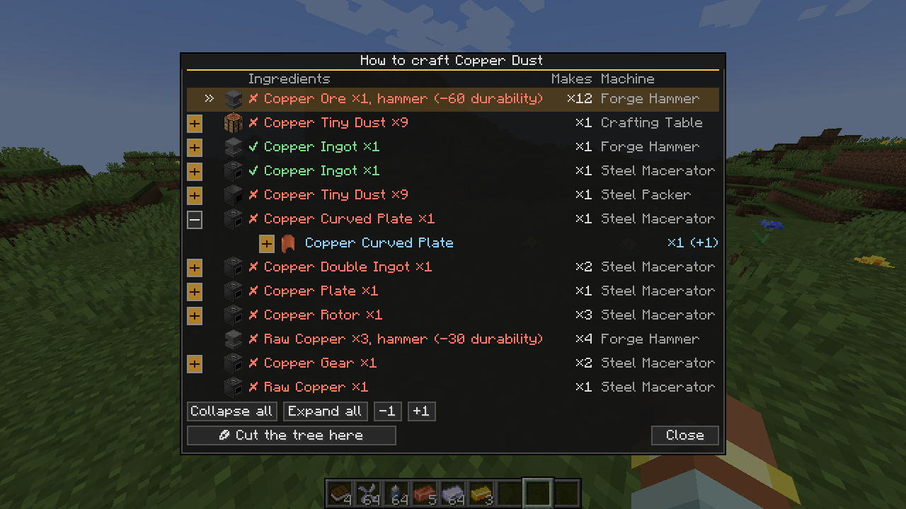
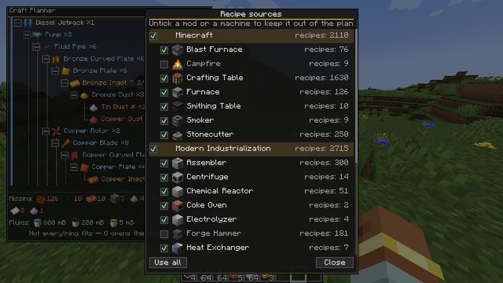

# Craft Planner

A client-side mod for NeoForge 1.21.1 (Java 21) that plans large builds.



Hover over an item in any screen — EMI, JEI or the plain inventory — and add it to
the plan. The mod expands the item into a craft tree down to the configured depth,
counts how many crafts it takes and shows which materials are missing, taking into
account what is already in your inventory. The tree is shown both in the HUD and in
a separate window; you can fold it branch by branch, pick a recipe variant and cut a
branch (a "cut" plans the item as a material to gather rather than something to
craft). The plan, recipe choices and cuts are kept between game sessions.

The mod is client-only: nothing needs to be installed on the server, it writes
nothing to the world and does not affect other players.

## What it looks like

The plan tree on top of the screen (V). The colour of a material shows what is
already in your inventory: green — you have it, yellow — partly (`~ 3/6`), red —
missing; blue marks what has to be crafted. At the bottom is a summary of missing
materials and fluids.



The tree window (G): the whole plan, with foldable branches and a recipe button on
every row.



Recipe choice: every way to obtain an item, with its ingredients, output and machine.
A branch can also be cut from here.



Recipe sources ("Sources…" in the K list): which mods and machines the plan may use.
Untick a whole mod or a single machine, and the tree stops using its recipes —
here the Forge Hammer is switched off, so the bronze branch on the left is
rebuilt through Bronze Plate. "Use all" turns everything back on.



## Building

```
./gradlew build
```

In PowerShell, use `.\gradlew.bat build`. The finished jar appears in `build/libs/`.
Put it into `mods/` together with NeoForge 21.1.248 or newer for Minecraft 1.21.1.

For development: `./gradlew runClient` starts the game with the mod, and
`./gradlew build test` builds the mod and runs the unit tests of the pure logic
(tree engine, quantity arithmetic, panel layout).

## Keys

All of them can be rebound in "Options → Controls → Craft Planner".

| Key | Action |
| --- | --- |
| N | add the item under the cursor to the plan and open the quantity window |
| K | list of planned goals: change the amount, remove a goal, toggle the ore filter, choose recipe sources |
| G | craft tree window: fold branches, pick a recipe, see what is missing |
| V | show or hide the tree on top of the screen (HUD) |
| O | panel layout editor: drag, resize and change the text scale |

## Files

They live in `config/` of the game directory.

| File | Contents |
| --- | --- |
| `craftplanner-client.toml` | settings: tree depth and size, colours and the "partly there" threshold, ore filter, panel position |
| `craftplanner-plan.json` | the goals and their amounts |
| `craftplanner-choices.json` | which recipe variant is chosen for an item |
| `craftplanner-cuts.json` | tree cuts |
| `craftplanner-sources.json` | mods and machines switched off in the recipe sources window |

## Dependencies

Only NeoForge 21.1.248 or newer is required: the mod is built and tested against
that version, and the loader will refuse older 21.1.x builds. EMI and JEI are
optional: without them the mod still works, it just cannot pick up the hovered
recipe from those screens or recognise their search fields.

## License

MIT, see [LICENSE](LICENSE).
